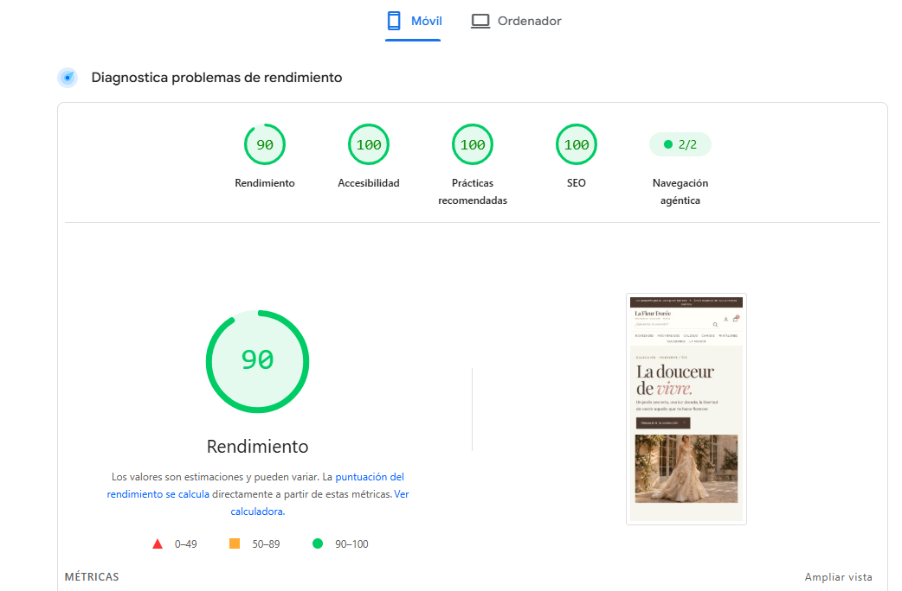

# La Fleur Dorée

La Fleur Dorée es un proyecto educativo que presenta la web de una marca ficticia de moda. El sitio es un prototipo estático pensado para mostrar el diseño y el recorrido de compra, no una tienda funcional.

**Web publicada:** [https://4geeksacademy.github.io/marais-an-la-fleur-doree/](https://4geeksacademy.github.io/marais-an-la-fleur-doree/)

## Vistas

- [Inicio](index.html) — portada y productos destacados.
- [Catálogo](catalog.html) — catálogo de veinte productos.
- [Producto](product.html) — ficha de ejemplo de la **Blusa Amélie**.
- [Carrito](cart.html) — vista estática del carrito de ejemplo.
- [Checkout](checkout.html) — formulario y resumen de compra estáticos.

## Tecnologías

- HTML semántico.
- Tailwind CSS mediante CDN.
- CSS para estilos y ajustes visuales.

## Alcance y limitaciones

El proyecto incluye un catálogo de veinte productos, una ficha de ejemplo de la Blusa Amélie, un carrito y una vista de checkout, todos estáticos. Los filtros y los botones de compra no ejecutan operaciones: no se procesan pagos ni se guarda el carrito de forma persistente. Los productos y sus precios son ficticios.

Las imágenes se generaron con inteligencia artificial y se optimizaron en formato WebP, con variantes responsive para distintos tamaños de pantalla.

## Ejecutar en Codespaces

En la terminal de Codespaces, inicia el servidor con:

```bash
python3 server.py
```

El servidor utiliza el puerto **3000**. Cuando Codespaces lo solicite, abre o reenvía ese puerto para ver el sitio.

## PageSpeed móvil

En una ejecución de PageSpeed para la **Home** se observaron estos resultados:

- Rendimiento: **90**
- Accesibilidad: **100**
- Buenas prácticas: **100**
- SEO: **100**



Estas puntuaciones corresponden a una ejecución de la Home; pueden variar entre ejecuciones y no se atribuyen a las demás vistas.

## Estado del proyecto

La versión completa está en la rama `feature/integration` y queda pendiente de revisión antes de fusionarse con `main`.

## Atribución

Este proyecto parte de la plantilla educativa HTML de [4Geeks Academy](https://github.com/4GeeksAcademy/html-hello/), creada como parte del [curso Full Stack Developer](https://4geeksacademy.com/us/coding-bootcamps/part-time-full-stack-developer). La plantilla original fue realizada por [Alejandro Sanchez](https://twitter.com/alesanchezr) y [otros contribuyentes](https://github.com/4GeeksAcademy/html-hello/graphs/contributors).
